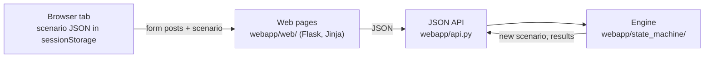
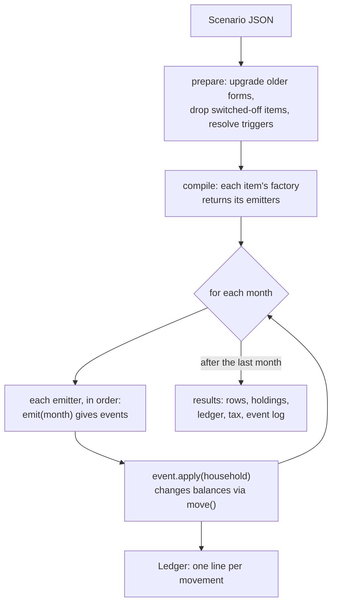

# Developer guide

Sloppy Wealth plays a household's finances forward month by month: incomes, expenses,
accounts, properties, mortgages, vehicles, pensions and taxes. This page gives you the
big picture. The [tutorials](tutorials/README.md) then walk you through common changes,
and the [reference](reference/README.md) describes every element.

If you have never used the app, spend ten minutes with the user guide's
[Getting started](../user/README.md) and one tutorial, such as
[Vehicle cost of ownership](../user/vehicle-cost-of-ownership.md). Everything below is
easier once you have seen a scenario being built and run.

## Run it and test it
From `webapp/`:

```
python3 -m venv .venv && .venv/bin/pip install -r requirements.txt   # once
.venv/bin/python app.py                                              # http://127.0.0.1:5000
.venv/bin/python -m unittest -q test_engine test_keep_payment test_ui_emitters test_api test_docs
.venv/bin/python -m unittest discover -s state_machine/tests -t .    # engine + golden suite
.venv/bin/python state_machine/tools/update_golden.py --check        # golden results unchanged?
```

All three test commands must pass before a pull request (see "Contributing" in the
[README](../../README.md)).

## The three layers


- **The scenario** is a JSON document: a few settings (horizon, opening cash, tax rates,
  inflation, jurisdiction) and a list of **items** (an income, an account, a mortgage…).
  Every item type is described in [items](reference/items.md).
- **The server keeps nothing.** The scenario lives in the browser tab. Every request
  sends it, the server answers with the new scenario or the results, and forgets it.
- **The web pages** only call the JSON API ([api](reference/api.md)); they never import
  the engine. Anything the pages can do, another client can do through the API.
- **The engine** turns a scenario into month-by-month results.

## The engine is a state machine
The engine keeps one piece of state, the **Household**, and changes it only through
**events**. Who decides that an event happens each month is the job of **emitters**.



- **Household** (`household.py`) holds cash, the **holdings** (properties, vehicles,
  mortgages, accounts, pensions), the persons with their tax, the ledger and the
  jurisdiction's rules.
- **Items compile to emitters.** Each item type has a factory registered with
  `@item_type("name")` (`compiler.py`). It returns one or more emitters: an income gives an
  emitter that pays it every month between its dates, a property gives a purchase, an
  appreciation and possibly a sale.
- **Emitters decide, events act.** Every month the runner (`runner.py`) asks each emitter,
  in a fixed order, whether something happens (`emit`). An emitter only *reads* the
  household; it returns events. The event's `apply` makes the change.
- **Every balance change is a movement**: `household.move(kind, from, to, amount, source)`
  rounds the amount to cents, changes both balances and writes one ledger line. The
  movement kinds are listed in [ledger](reference/ledger.md).
- **Rules** are calculators events call: tax, indexing, investment returns
  ([rules](reference/rules.md)).
- **Results** (`results.py`) record a row and the holdings' balances at the end of each
  month ([outputs](reference/outputs.md)).

### The month order
Emitters run sorted by an order number (`clock.Order`), so each month always goes through
the same steps:

| Step | What happens |
|---|---|
| INITIAL | once, before the first month: holdings that exist at the start |
| OPEN | the month begins; retirement, triggers |
| INCOME, PENSION_PAY | incomes and pensions are paid |
| ACQUIRE, IMPROVE, ADJUST, SELL, TRANSFER | purchases, loans advanced, accounts opened, improvements, value changes, sales, transfers |
| SERVICE_DEBT | mortgage interest and payments, renewals, prepayments |
| EXPENSE, MAINTAIN | expenses |
| CONTRIBUTE, WITHDRAW | money into and out of accounts and pensions |
| GROW, REVALUE_PENSIONS | appreciation, depreciation, account returns |
| TAX | each person's tax for the month |
| CLOSE | the month's results are recorded |

The steps are 100 apart, so a new emitter can be placed between two of them.

### A tiny run
A scenario with $1,000 of cash, a salary of $4,000 a month, rent of $1,500 and 25% tax
produces, in its first month, these ledger lines and this result row:

```
2027-01  INCOME   None -> cash  4000.00  source salary
2027-01  EXPENSE  cash -> None  1500.00  source rent
2027-01  TAX      cash -> None  1000.00
row 2027-01: cash 2500.00, netWorth 2500.00
```

`None` means outside the model: money that comes in from, or goes out to, the world.

## Jurisdictions
Everything country-specific (account types such as RRSP or 401(k), how each is taxed,
contribution limits, the items only one country has) lives in a plug-in package under
`state_machine/jurisdictions/` (Canada `ca/`, United States `us/`). The core asks the
scenario's jurisdiction instead of checking for "RRSP". See
[jurisdictions](reference/jurisdictions.md).

## Where things live
| Path | What |
|---|---|
| `webapp/state_machine/` | the engine: `household.py`, `runner.py`, `clock.py`, `emitters.py`, `compiler.py`; items in `holdings/`, `events/`, `flows/`; calculators in `rules/`; `jurisdictions/`; `validation.py`, `upgrade.py`, `results.py`; derived views (`views.py`, `cards.py`, `break_even.py`, `vehicle_cost.py`); scenario commands (`ops.py`) |
| `webapp/api.py` | the JSON API |
| `webapp/schema.py` | the forms: fields, hints, choices and groups of each item type |
| `webapp/web/` | the web pages (an API client) |
| `webapp/SPEC.md` | the scenario JSON format and engine semantics (binding) |
| `docs/adr/` | architecture decisions, numbered; the *why* behind the rules |

More in [modules](reference/modules.md).

## Diagrams
- [Diagram 06, the event-emitter model](../../diagrams/06-event-emitter-conceptual.mmd)
  shows the engine's classes as built.
- Diagrams 01 to 05 show the planning-era design that the engine implements in its own
  way; read them for the domain ideas, not for code. Diagram 02 is the target domain model,
  not all of it built.

## Rules of the house
- Money is `decimal.Decimal`, rounded to cents when a movement is made; rates are
  fractions in JSON and percentages in forms.
- Change balances only through `household.move`.
- Emitters decide, events act; emit nothing in months where nothing happens.
- The **golden suite** freezes the results of 240+ scenarios. If your change alters
  results on purpose, review the differences (`update_golden.py --check`), regenerate,
  and say why in the commit message. Never regenerate to hide a difference you can't
  explain.
- Never commit personal data: examples and test scenarios are synthetic.

The full rule book, including how decisions are recorded, is [CLAUDE.md](../../CLAUDE.md).

## Next
Start with a [tutorial](tutorials/README.md):

- [Add an item type](tutorials/add-item-type.md)
- [Extend a jurisdiction](tutorials/extend-jurisdiction.md)
- [Create a jurisdiction](tutorials/new-jurisdiction.md)
- [Add a rule](tutorials/add-rule.md)
- [Change the output](tutorials/change-output.md)
