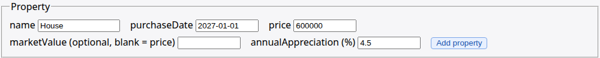
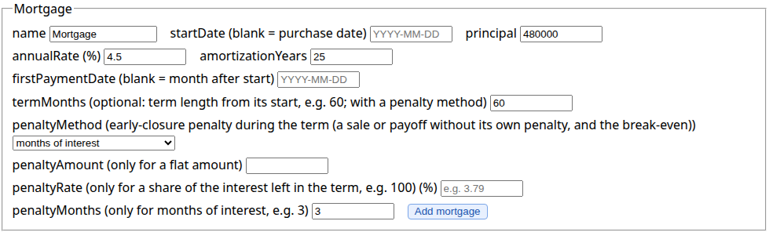
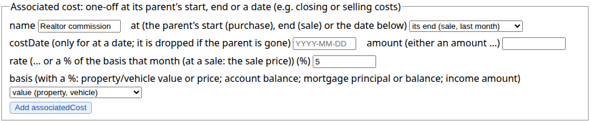
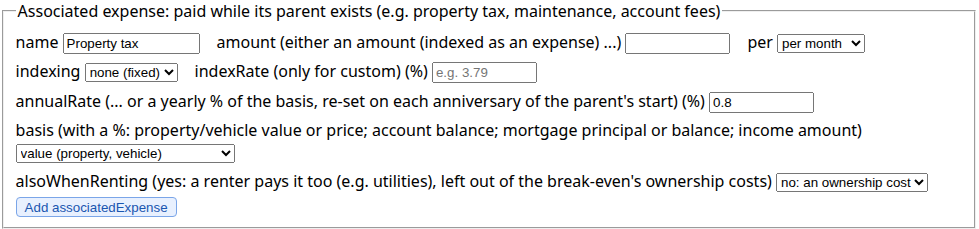
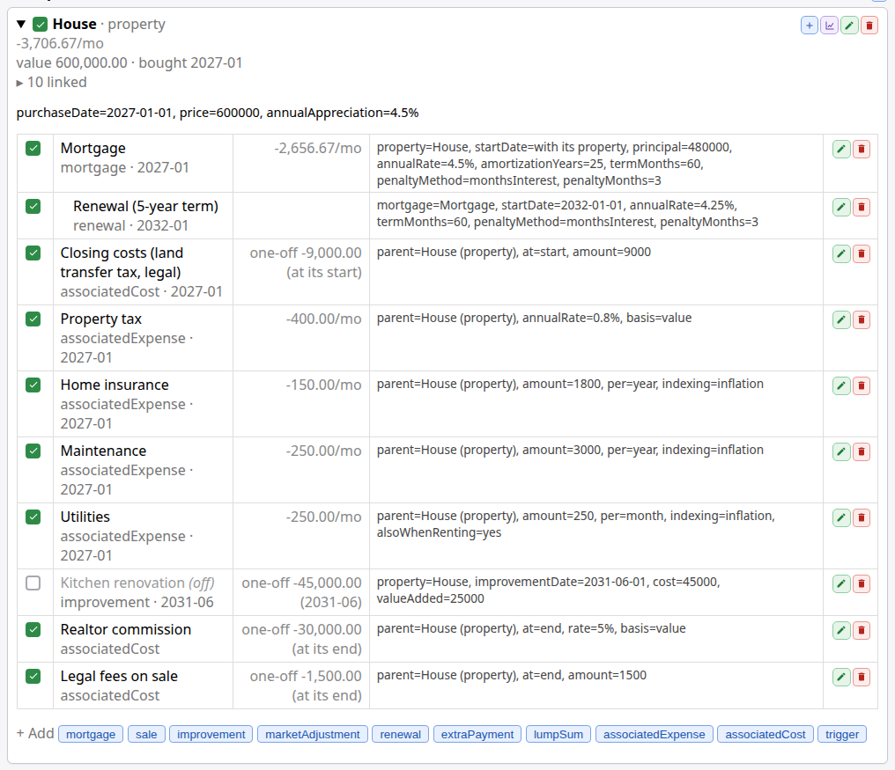
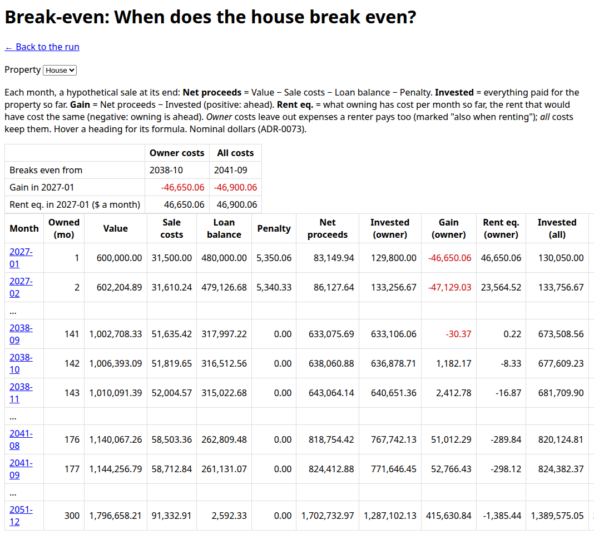
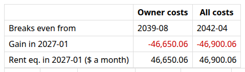

# When a house breaks even

*When can I sell the house without losing the money I put into buying and maintaining it?*

Buying a house costs more than its price: closing costs, mortgage interest, property tax,
insurance, maintenance, and when you sell, the realtor and possibly a penalty for closing
the mortgage early. This tutorial adds all of that to a house, then uses the **break-even**
calculator to find the first month in which selling would give you back everything you
put in. It takes about 15 minutes. All figures are illustrative: replace them with your
own.

To start from the finished scenario, download
[house-break-even.json](files/house-break-even.json), open **Load** in the app and upload
it, then jump to [Read the break-even](#5-read-the-break-even).

## What you need
- Sloppy Wealth running (see [Getting started](README.md)).
- The price and the mortgage (amount, rate, amortization, term), your closing costs, the
  selling costs you expect, and the yearly running costs.

## 1. Start the scenario
Click **New**, choose your jurisdiction and click **Start**. In the **Scenario** card
(under **Household**) set:

- **Horizon** from `2027-01-01` to `2051-12-01` (25 years, the length of the mortgage).
- **Opening cash** `150000` (the down payment and closing costs come out of it).
- **Income tax** `0`, **Inflation** `2.5` (%), **Show real values in dollars of**
  `2027-01-01`.

Then, under your person's **Income** category, add an income `Take-home pay` of `7000` per
month from `2027-01-01`, not taxable, indexed to inflation, so that cash can pay the
mortgage. Income doesn't count in the break-even; it only keeps the cash positive.

[Lease or buy a vehicle](vehicle-lease-or-own.md) shows these first steps with
screenshots.

## 2. The house and its mortgage
### The house
In the **Properties** category, click **property** next to **+ Add**: name `House`,
purchase date `2027-01-01`, price `600000`, appreciation `4.5` (%) a year.

### The mortgage
Open the house's card and click **mortgage** under **+ Add**. The mortgage is tied to the
house and starts with it. Enter the principal `480000` (20% down), rate `4.5` (%),
amortization `25` years.

The last fields describe the **term** and what closing the mortgage early would cost:
**termMonths** `60` (a five-year term), **penaltyMethod** "months of interest" and
**penaltyMonths** `3`, the usual Canadian penalty. After the term ends there is no
penalty until the next term starts. Other methods: a flat amount, or a share of the
interest left in the term.

The term ends in 2031. On the house's card, click **renewal** and add the next term:
start `2032-01-01`, rate `4.25` (%), with the same **termMonths** `60` and penalty of 3
months' interest.

## 3. The costs of buying and selling
These are one-off **associated costs** on the house's card. Click **associatedCost** and
add:

| Name | At | Amount or rate |
|---|---|---|
| Closing costs (land transfer tax, legal) | its start | amount `9000` |
| Realtor commission | its end | rate `5` (%), basis value |
| Legal fees on sale | its end | amount `1500` |

Costs "at its end" are what a sale would cost. The break-even applies them to every month
as if you sold then; they are only actually paid if the scenario sells the house.

## 4. The costs of owning it
Running costs are **associated expenses**, paid every month while you own the house.
Click **associatedExpense** and add:

| Name | Amount | Indexing | Also when renting |
|---|---|---|---|
| Property tax | yearly rate `0.8` (%), basis value | (follows the value) | no |
| Home insurance | `1800` per year | inflation | no |
| Maintenance | `3000` per year | inflation | no |
| Utilities | `250` per month | inflation | **yes** |

Property tax is a percentage of the house's value, re-set every year, so it rises with
the value.

**Also when renting** marks costs that a renter would pay too, such as utilities. The
break-even shows two versions: *owner costs* leave those out (the fair comparison with
renting), and *all costs* keep them.

The house's card now holds everything: the mortgage and its renewal, the one-off costs and
the running costs.

(The switched-off **Kitchen renovation** in the picture is used in step 6.)

## 5. Read the break-even
Click the purple **chart icon** on the house's card. For every month, the break-even page
imagines a sale at the end of that month:

- **Net proceeds** = value − sale costs − loan balance − early-closure penalty: the cash
  the sale would bring.
- **Invested** = everything paid for the house so far: the down payment, closing costs,
  every mortgage payment, the property tax, insurance and maintenance.
- **Gain** = net proceeds − invested. Negative: selling now would lose money. Positive:
  you are ahead.
- **Rent eq.** = what owning has cost per month so far, the rent that would have cost the
  same. It is negative once owning is ahead.

Hover a column's heading for its formula.

Reading it:

- **In the first month**, a sale would lose **$46,650**: the closing costs ($9,000), the
  realtor and legal fees ($31,500), the mortgage penalty ($5,350) and the month's running
  costs ($800) are all lost at once.
  Hence the huge rent equivalent at the start: those costs are spread over a single
  month.
- The house **breaks even in 2038-10**, after 142 months (almost 12 years), on owner
  costs: a sale then would bring $638,060.88 against $636,878.71 put in.
- Counting the utilities too (*all costs*), it breaks even in **2041-09**.
- After 25 years, in 2051-12, a sale would leave you **$415,630.84 ahead**: owning has
  *earned* about $1,385 a month compared with paying rent.
- Selling inside a mortgage term costs its penalty. In 2032-01, the first month of the
  renewal's term, the penalty is back at $4,438.15; in 2031-12, between terms, it is 0.

## 6. What moves the break-even
Change one thing at a time and open the break-even page again: it is recalculated
instantly.

**A renovation.** On the house's card, add an **improvement**: `Kitchen renovation` on
`2031-06-01`, cost `45000`, value added `25000` (renovations rarely add their full cost to
the value). Tick or untick its checkmark to include it or not.

With it, the house breaks even in **2039-08** instead of 2038-10: the $20,000 the
renovation doesn't add to the value takes about ten more months to earn back.

**Appreciation.** It matters most. Change the house's appreciation from 4.5% to 3% (the
green pencil on the house's card): the house then **never breaks even** within 25 years,
because the interest, tax and upkeep outpace a 3% rise in value.

**The mortgage.** A lower rate, prepayments (**extraPayment**, **lumpSum** on the house's
card) or a shorter amortization cut the interest paid and bring the break-even forward.

## Make it closer to your situation
- **A house you already own.** Set the horizon to start in the month you bought it, so the
  mortgage, which must start inside the horizon, is included from the beginning. If you
  start the horizon later instead, the break-even counts the house's equity at that date
  as already invested and starts counting months from there.
- **A drop in prices.** A **marketAdjustment** on the house's card changes its value on a
  date, by a percentage or to a new value.
- **The actual sale.** If you plan to sell, add a **sale** on the house's card: it pays off
  the mortgage, charges the penalty if the term isn't over, and pays the selling costs.
  The break-even table ends the month before.
- **Save your work** with **Save** in the menu; the browser tab forgets it once closed.

The answer is a ballpark: as good as the figures you enter, appreciation above all.
