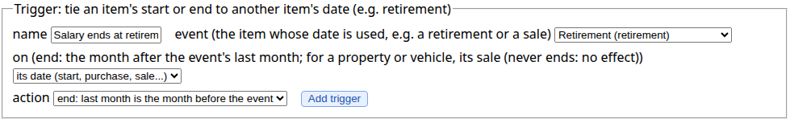
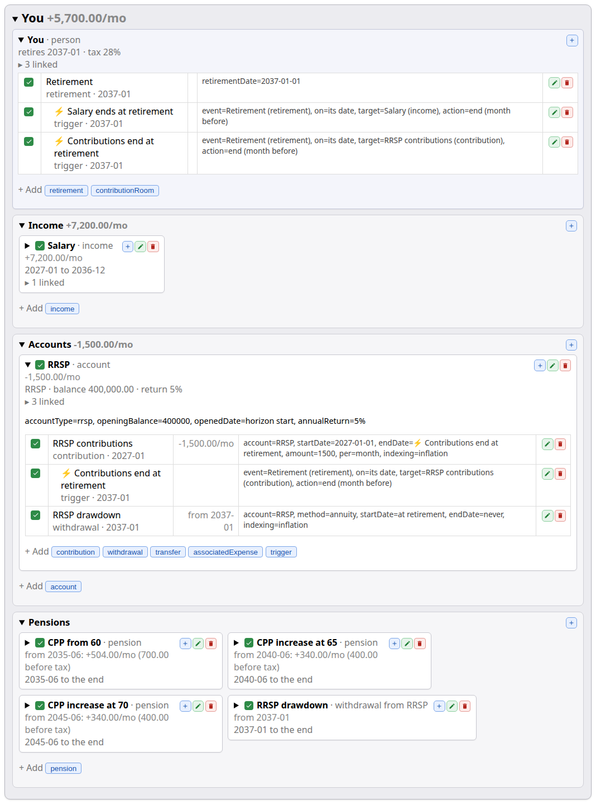
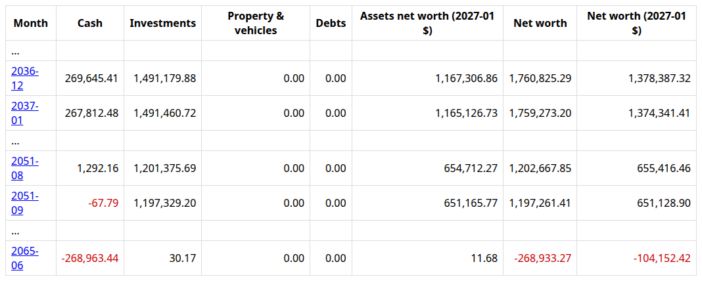
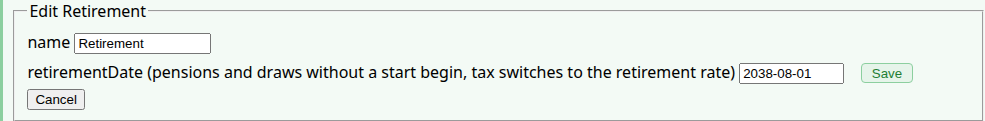
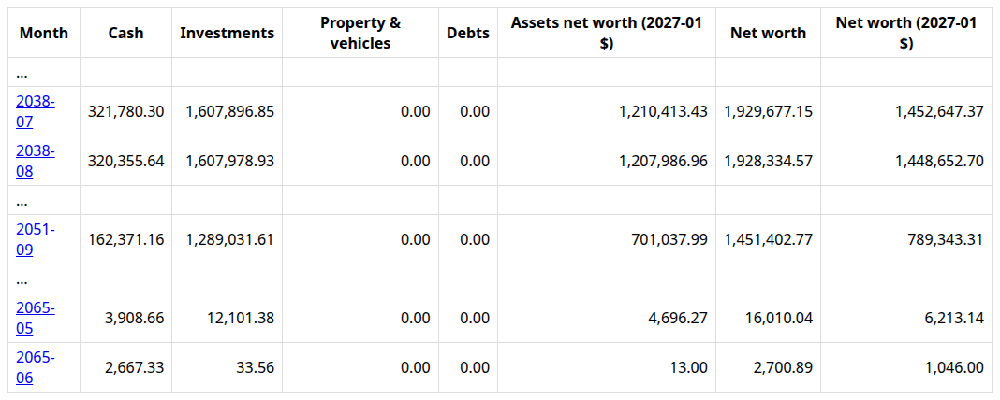

# When can I retire

*When can I retire with an income of $NNN in today's dollars?*

This tutorial models one person who wants to retire on **$4,500 a month in today's
dollars**, living on an RRSP and the Canada Pension Plan (CPP). It finds the earliest
retirement date at which the money lasts until age 90. It takes about 20 minutes. All
figures are illustrative: replace them with your own.

To start from the finished scenario, download [retirement.json](files/retirement.json),
open **Load** in the app and upload it, then jump to
[Find the earliest date](#5-find-the-earliest-date).

## How the question is set up
- The **income you want** is your spending: living expenses of $4,500 a month in today's
  dollars, rising with inflation every year, before and after retirement.
- **Before retiring**, a salary pays the expenses and RRSP contributions; what is left
  accumulates as cash.
- **From retirement**, the salary and the contributions stop. The RRSP is drawn down so
  that it lasts until the end, and CPP pays from age 60, with increases at 65 and 70.
- You **can retire** at a date if cash never runs out before age 90, the end of the
  horizon.

The person in the example was born in June 1975: 60 in 2035-06, 65 in 2040-06, 70 in
2045-06 and 90 in 2065-06.

## What you need
- Sloppy Wealth running (see [Getting started](README.md)).
- Your salary, spending, RRSP balance and contributions, and your CPP estimates (your
  Service Canada statement gives them).

## 1. Start the scenario
Click **New**, choose **Canada** and click **Start**. In the **Scenario** card (under
**Household**) set:

- **Horizon** from `2027-01-01` to `2065-06-01` (until age 90).
- **Opening cash** `40000`.
- **Income tax** `28` (%) while working and **Retirement tax** `15` (%) after retiring:
  the app switches from one to the other at the retirement date.
- **Inflation** `2.5` (%), **Show real values in dollars of** `2027-01-01`.

## 2. Working life
Under your person (**You**):

- **Income**: `Salary`, `120000` per year from `2027-01-01`, taxable, indexed to inflation.
  No end date: retirement will end it.
- **Accounts**: an **account** `RRSP`, type RRSP, opening balance `400000`, return `5` (%).
  On its card, a **contribution** of `1500` per month from `2027-01-01`, indexed to
  inflation (contributions are deducted from taxable income).

Under **Household**, **Expenses**: `Living expenses`, `4500` per month from `2027-01-01`,
**amountIn** "today's dollars", indexed to inflation. This is the retirement income you
are aiming for.

## 3. Retirement
### The retirement date
On your person's card, click **retirement** under **+ Add** and give a first guess:
`2037-01-01` (at 61½).

### What stops at retirement
A **trigger** ties an item's start or end to another item's date. On the salary's card,
click **trigger**: event **Retirement**, action **end** (its last month is the month before
retirement). For the RRSP contributions, which sit as a row on the RRSP's card, open
**Builder (flat)** and add a **trigger** under **Triggers**: event **Retirement**, target
**RRSP contributions**, action **end**.

Moving the retirement date later moves both ends with it.

### Drawing the RRSP down
On the RRSP's card, add a **withdrawal**, method **annuity**, indexed to inflation, and
leave its start date blank: a withdrawal without a start date begins at retirement. An
annuity spreads the balance over the months left, rising with inflation, so the RRSP
lasts exactly until the end of the horizon. Withdrawals are taxed (at the retirement rate).

### CPP
CPP pays from age 60 and, in this tutorial, increases at 65 and 70. In **Pensions**, add
three **pensions**, each taxable, indexed to inflation, with amounts in today's dollars:

| Name | Amount per month | Start |
|---|---|---|
| CPP from 60 | 700 | 2035-06-01 |
| CPP increase at 65 | 400 | 2040-06-01 |
| CPP increase at 70 | 400 | 2045-06-01 |

So CPP is $700 a month at 60, $1,100 at 65 and $1,500 at 70, in today's dollars.

Your person's section now holds the whole plan: the retirement and its triggers, the
salary, the RRSP with its contributions and drawdown, and CPP.

## 4. Run it
Click **Run** and look at the **Cash** column.

Retiring in 2037-01, cash turns negative in **2051-09** (at 76) and ends **$268,963 short**:
not enough. (**Investments** holds the RRSP and the value of the CPP pensions; the RRSP is
spread to the end on purpose, so it is the cash that tells whether the spending is
covered.)

## 5. Find the earliest date
Move the retirement date later until cash stays positive to the end. On your person's
card, click the green **pencil** on the **Retirement** row, change the date and click
**Save**; then **Run** again.

| Retirement | Cash at the end (2065-06) | |
|---|---|---|
| 2037-01 | −$268,963.44 | runs out in 2051-09 |
| 2038-07 | −$11,903.49 | runs out just before the end |
| **2038-08** | **$2,667.33** | **lasts until 90** |

So with these figures you can retire in **August 2038, at 63**, on $4,500 a month in
today's dollars.

In the first month of retirement, CPP pays $918.46 and the RRSP $4,387.52, less $795.90 of
tax, against $5,904.39 of living expenses (the $4,500 grown by twelve years of inflation).
The cash saved while working covers the difference until the CPP increases at 65 and 70.

## 6. What moves the date
Change one thing at a time and run again:

- **Spending.** A lower target is a strong lever: edit the living expenses.
- **Saving more** while working: a larger RRSP contribution, or a TFSA (an **account** of
  type TFSA, with a **withdrawal** at retirement like the RRSP's).
- **CPP timing.** Starting CPP later pays more each month; change the pensions' start
  dates and amounts.
- **Returns.** The RRSP's 5% return matters a lot over 40 years; try 4% or 6%.

## Make it closer to your situation
- **A spouse.** Add a second **person** (under **Household**) with their own income,
  accounts, CPP and retirement date; items then belong to one person or the other.
- **Spending that changes in retirement.** An **adjustment** on the living expenses gives
  them a new amount from a date.
- **OAS** (Old Age Security, from 65) is another pension.
- **Save your work** with **Save** in the menu; the browser tab forgets it once closed.

The answer is a ballpark: as good as the figures you enter, returns and inflation above
all.
