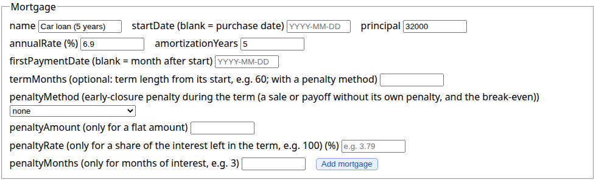
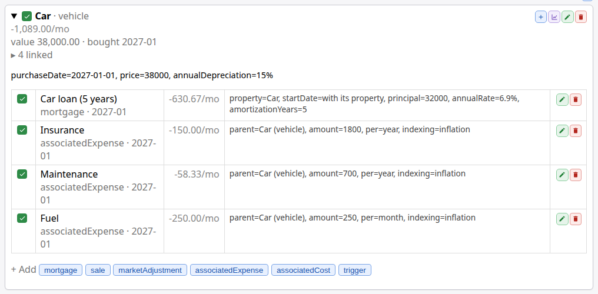
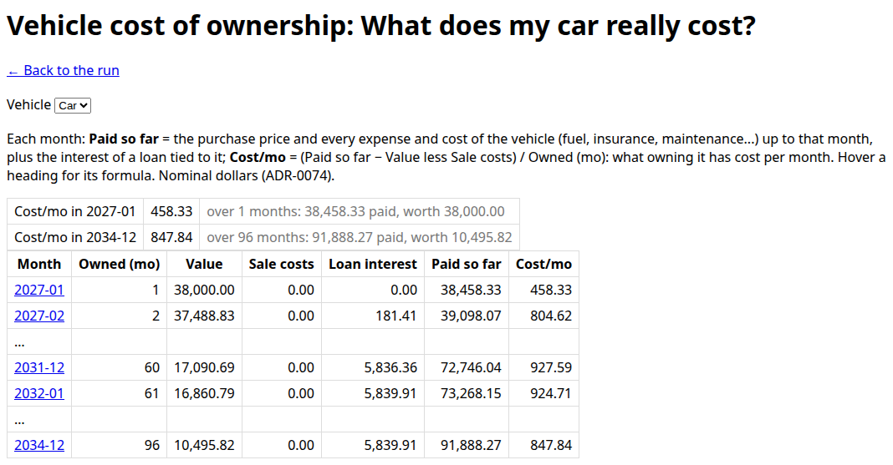
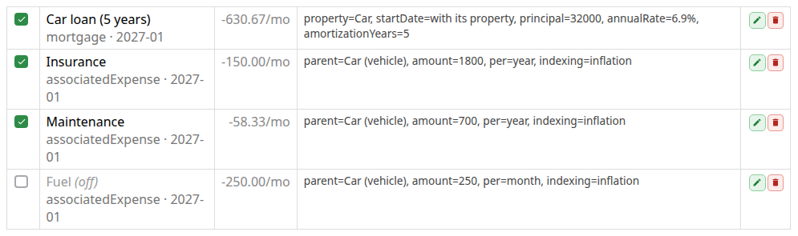
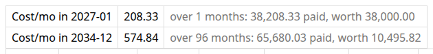

# Vehicle cost of ownership

*What does my car really cost me per month, financing included, and how much of it is
fuel?*

A car costs far more than its loan payment: the value it loses, the loan's interest,
insurance, maintenance and fuel. This short tutorial models one car bought with a
five-year loan and reads what owning it costs per month, first with fuel, then without.
It takes about 10 minutes. All figures are illustrative: replace them with your own.

To start from the finished scenario, download
[vehicle-cost-of-ownership.json](files/vehicle-cost-of-ownership.json), open **Load** in
the app and upload it, then jump to [Read the cost](#3-read-the-cost-per-month).

## What you need
- Sloppy Wealth running (see [Getting started](README.md)).
- The car's price and your down payment, the loan (rate and length), and the yearly
  running costs.

## 1. Start the scenario
Click **New**, choose your jurisdiction and click **Start**. In the **Scenario** card
(under **Household**) set the horizon from `2027-01-01` to `2034-12-01` (eight years, how
long you plan to keep the car), **Opening cash** `20000`, **Income tax** `0` and
**Inflation** `2.5` (%).

Under your person's **Income** category, add `Take-home pay` of `4000` per month from
`2027-01-01`, not taxable, indexed to inflation, so that cash can pay for the car. Income
doesn't count in the car's cost.

## 2. The car and its loan
### The car
In the **Vehicles** category, click **vehicle** next to **+ Add**: name `Car`, purchase date
`2027-01-01`, price `38000`, losing `15` (%) of its value a year.

### The loan
Open the car's card and click **mortgage** under **+ Add**: in the app, any loan is a
"mortgage", and one added on a vehicle's card finances that vehicle. Enter the amount
borrowed, `32000` (the price less a $6,000 down payment), the rate `6.9` (%) and
amortization `5` years. Leave the start date blank: the loan starts with the purchase.

The money borrowed goes into cash, which pays the full price; the loan's payments then
follow monthly ($630.67 here), and its interest counts as a cost of the car.

### The running costs
On the car's card, click **associatedExpense** and add:

| Name | Amount | Per | Indexing |
|---|---|---|---|
| Insurance | 1800 | year | inflation |
| Maintenance | 700 | year | inflation |
| Fuel | 250 | month | inflation |

The car's card now shows the loan and the three costs, with this month's estimates.

## 3. Read the cost per month
Click the purple **chart icon** on the car's card. For every month, the **Vehicle cost of
ownership** page shows:

- **Value**: what the car is worth.
- **Loan interest**: the interest paid on its loan so far.
- **Paid so far**: the price, plus the interest and every running cost so far.
- **Cost/mo**: (paid so far − value) ÷ months owned, what owning the car has cost per
  month.

With fuel, the car costs **$927.59 a month** over the five years of the loan, and **$847.84
a month** over the eight years: keeping a car longer spreads its loss of value and the
loan's interest ($5,839.91 in all) over more months.

The cost per month starts low ($458.33 in the first month: one month of running costs, and
a car still worth its price) and climbs as the value falls.

## 4. The same car without fuel
Fuel depends on how much you drive, so it helps to see the cost without it. On the car's
card, untick the **checkmark** on the **Fuel** row. It turns grey and leaves the
calculation, but stays in the scenario.

Open the cost of ownership page again:

| | With fuel | Without fuel |
|---|---|---|
| Cost per month over 5 years | $927.59 | $664.77 |
| Cost per month over 8 years | $847.84 | $574.84 |

So fuel is about **$273 a month** of this car's cost, and the car itself (value lost,
interest, insurance and maintenance) about **$575**. Tick the checkmark again to bring fuel
back. Any item can be switched the same way: try the insurance, or the loan (the car then
is paid in cash, without interest).

## Make it closer to your situation
- **Maintenance that grows with age**: see
  [Lease or buy a vehicle](vehicle-lease-or-own.md) for steps by age.
- **Selling the car.** Add a **sale** on its card at the date you would sell: it pays off
  what is left of the loan, and the table ends the month before.
- **Other costs.** Registration, tires or parking are more associated expenses; a one-off
  repair is an associated cost on a date.
- **Save your work** with **Save** in the menu; the browser tab forgets it once closed.

The answer is a ballpark: as good as the figures you enter.
