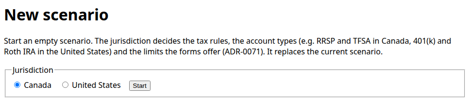
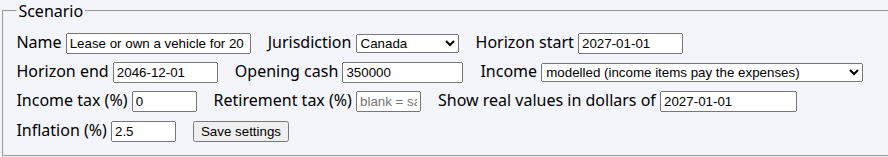
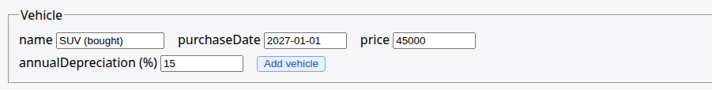
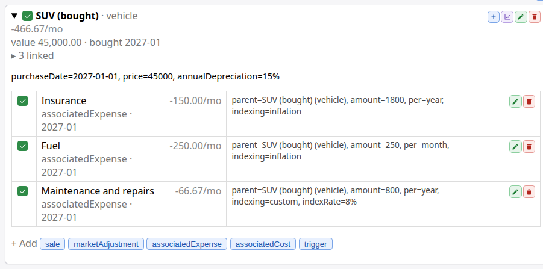
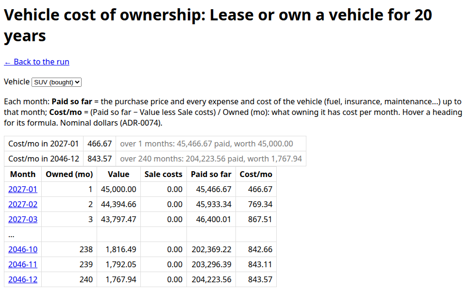
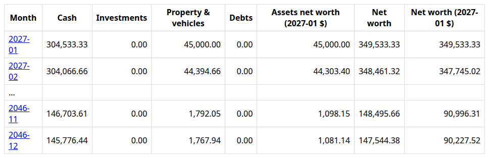
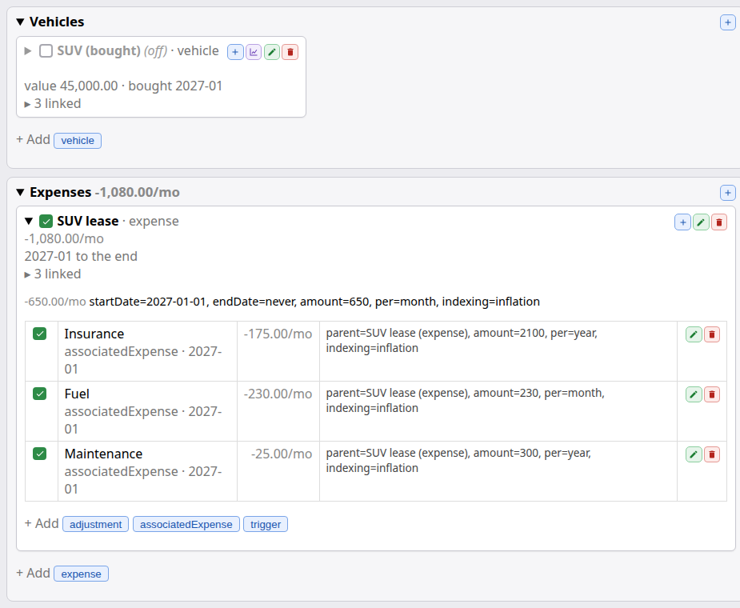

# Would it be cheaper to lease a vehicle than to keep and maintain one for 20 years?

This tutorial builds a small scenario with both options: buying an SUV and keeping it for
20 years, or leasing one for the same 20 years. It then switches between them to see
which leaves you with more money. It takes about 15 minutes. All figures are
illustrative: replace them with your own.

If you would rather start from the finished scenario, download
[vehicle-lease-or-own.json](files/vehicle-lease-or-own.json), open **Load** in the app and
upload it. Then jump to [Compare the two options](#5-compare-the-two-options).

## What you need
- Sloppy Wealth running (see "Quick start" in the [README](../../README.md)), open at
  http://127.0.0.1:5000.
- For each option, rough figures: the price or the lease payment, and the yearly running
  costs (insurance, fuel, maintenance).

The model works month by month. Every amount below can grow with inflation, so a cost you
enter is in today's dollars and rises each year.

## 1. Start a new scenario
Click **New** in the top menu, choose your jurisdiction and click **Start**. The
jurisdiction only matters for tax and investment accounts, which this question doesn't
use.

## 2. Set the scenario's horizon
In the builder, open the **Scenario** card (under **Household**) and fill in its settings:

- **Horizon start** `2027-01-01` and **Horizon end** `2046-12-01`: 20 years, one month
  at a time.
- **Opening cash** `350000`: any amount large enough that cash doesn't go negative. Only
  the *difference* between the two options matters.
- **Income tax** `0`: neither option involves income or tax.
- **Inflation** `2.5` (%), and **Show real values in dollars of** `2027-01-01`, so the
  results can also be read in today's dollars.

Click **Save settings**.

## 3. Option A: buy the vehicle and keep it
### Add the vehicle
In the **Vehicles** category, click **vehicle** next to **+ Add** and enter its name, purchase date,
price and how much value it loses per year (15% is typical for the first years). Click
**Add vehicle**.

### Add its running costs
Running costs are *associated expenses*: they are attached to the vehicle and stop when
it is sold or switched off. Open the vehicle's card, click **associatedExpense** under
**+ Add**, and fill in one cost at a time:

| Name | Amount | Per | Indexing |
|---|---|---|---|
| Insurance | 1800 | year | inflation |
| Fuel | 250 | month | inflation |
| Maintenance and repairs | 800 | year | custom, 8% |

Maintenance uses a custom 8% a year because an ageing vehicle costs more to keep running.

The card now shows the vehicle with its three costs and an estimate for this month.

### See what owning it costs per month
Click the purple **chart icon** on the vehicle's card. The **Vehicle cost of ownership**
page shows, month by month, everything paid for the vehicle so far, its value, and the
cost per month of owning it: (paid so far − value) ÷ months owned.

After 20 years, owning this SUV has cost **$843.57 a month** on average (in the dollars
of each year, so later years count at their inflated prices). Its value has fallen to
$1,767.94.

### Note the result
Click **Run** in the top menu and scroll to the last month. **Net worth** is what you are
left with: cash plus the vehicle's remaining value.

Owning: **$147,544.38** at the end, or $90,227.52 in today's (2027) dollars.

## 4. Option B: lease instead
A lease is an expense with its own running costs. In the **Expenses** category, click
**expense** next to **+ Add** and enter the lease payment: name `SUV lease`, start `2027-01-01`, no
end date, `650` per month, indexed to inflation. Leaving the end empty means you keep
leasing, one lease after another, for the whole horizon.

Then open the lease's card and add its running costs the same way as for the vehicle:

| Name | Amount | Per | Indexing |
|---|---|---|---|
| Insurance | 2100 | year | inflation |
| Fuel | 230 | month | inflation |
| Maintenance | 300 | year | inflation |

Leases usually require fuller insurance, while a newer vehicle uses a little less fuel
and needs little maintenance.

### Switch the bought vehicle off
Both options can live in the same scenario: you only switch one off. Untick the
**checkmark** on the SUV's card. The vehicle and everything attached to it turn grey and
leave the calculation, while staying in the scenario so you can switch them back on.

Click **Run** again and scroll to the last month.

Leasing: **$18,941.24** at the end, or $11,583.10 in today's dollars. Nothing is left to
sell at the end of a lease.

## 5. Compare the two options
| | Own (buy and keep) | Lease (20 years) |
|---|---|---|
| Net worth after 20 years | $147,544.38 | $18,941.24 |
| In 2027 dollars | $90,227.52 | $11,583.10 |
| Average cost per month | $843.57 | $1,379.41 |

With these figures, **owning is cheaper by about $128,600 over 20 years** (about $78,600
in today's dollars). The lease's average comes from the run: everything paid over the 20
years, $331,058.76, divided by 240 months.

To flip between the options at any time, switch one card's checkmark off and the other's
on, then run again. Try different figures to see where the answer changes: a cheaper
lease, a pricier vehicle, or maintenance that grows faster as the vehicle ages.

## Make it closer to your situation
- **Replacing the vehicle.** If you would replace it after, say, 10 years, add a **sale**
  on the vehicle's card at that date and a second vehicle bought then.
- **Lease extras.** A down payment or end-of-lease fees can be added as expenses with the
  same start and end month (a one-off).
- **Financing the purchase.** This scenario pays cash. A car loan can be entered as a
  **mortgage** with no property: its principal, rate, amortization and start date. The
  loan's money arrives in cash, which pays the vehicle, and its payments follow.
- **Money not spent up front.** Cash earns nothing in this model. If you would invest the
  purchase price instead, add an **account** with a return and a one-off **transfer** into
  it in the lease option.
- **Save your work.** Click **Save** in the menu to download the scenario as a JSON file;
  the browser tab forgets it once closed.

The answer is a ballpark. It is as good as the figures you enter, and the model ignores
things such as lease mileage limits, resale negotiations and accidents.
