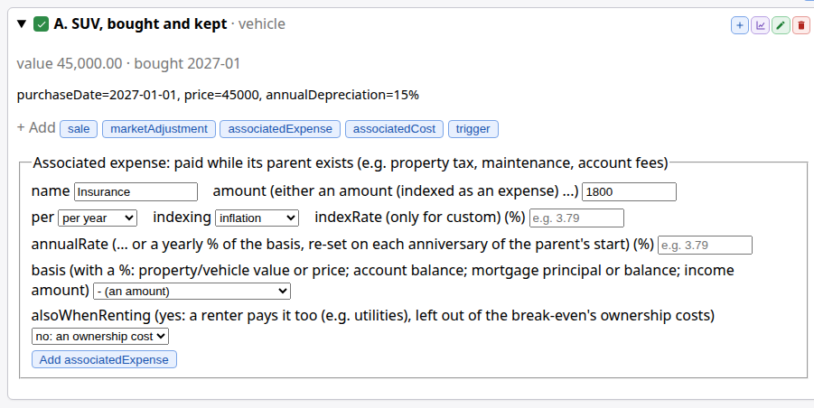
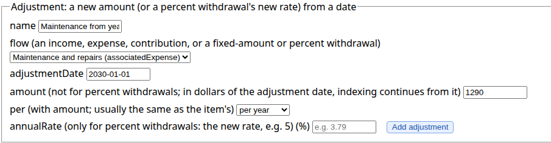
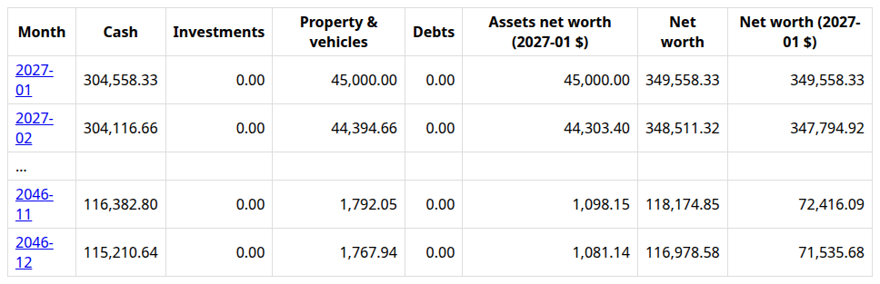
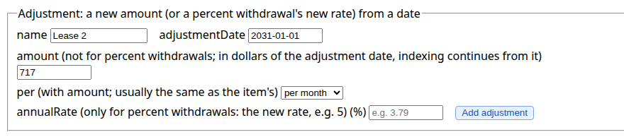
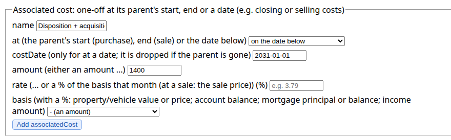
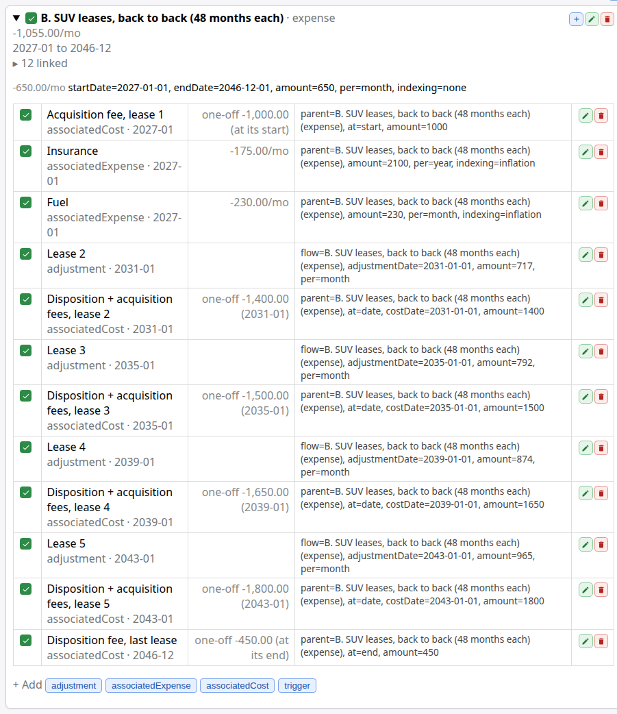
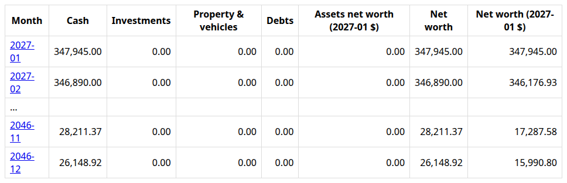
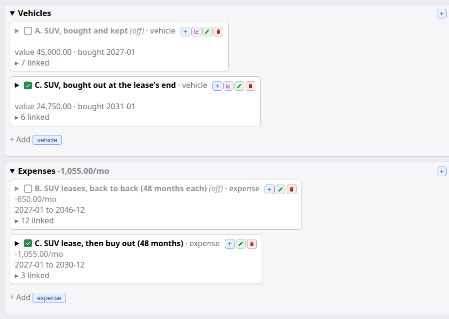
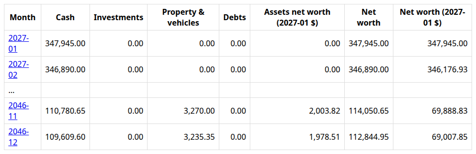

# Would it be cheaper to lease a vehicle than to keep and maintain one for 20 years?

This tutorial compares three ways of having an SUV for the next 20 years:

- **A. Buy it and keep it** for the whole 20 years.
- **B. Lease, back to back**: a new 48-month lease every four years, five in all.
- **C. Lease once, then buy it out**: lease for 48 months, buy the vehicle at the end of
  the lease for its residual value, and keep it for the remaining 16 years.

All three live in one scenario; you switch two of them off to see the third. It takes
about 20 minutes. All figures are illustrative: replace them with your own.

If you would rather start from the finished scenario, download
[vehicle-lease-or-own.json](files/vehicle-lease-or-own.json), open **Load** in the app and
upload it, then jump to [Compare the three options](#6-compare-the-three-options).

## What you need
- Sloppy Wealth running (see "Quick start" in the [README](../../README.md)), open at
  http://127.0.0.1:5000.
- Rough figures for each option: the price, the lease payment and its fees, the
  residual (buy-out) value, and the running costs (insurance, fuel, maintenance).

The model works month by month. Amounts can grow with inflation, so a cost you enter
keeps its purchasing power and rises each year.

## 1. Start a new scenario
Click **New** in the top menu, choose your jurisdiction and click **Start**. The
jurisdiction only matters for tax and investment accounts, which this question doesn't
use.

## 2. Set the scenario's horizon
In the builder, open the **Scenario** card (under **Household**) and fill in its settings:

- **Horizon start** `2027-01-01` and **Horizon end** `2046-12-01`: 20 years, one month
  at a time.
- **Opening cash** `350000`: any amount large enough that cash doesn't go negative. Only
  the *differences* between the options matter.
- **Income tax** `0`: none of the options involves income or tax.
- **Inflation** `2.5` (%), and **Show real values in dollars of** `2027-01-01`, so the
  results can also be read in today's dollars.

Click **Save settings**.

## 3. Option A: buy it and keep it
### Add the vehicle
In the **Vehicles** category, click **vehicle** next to **+ Add** and enter its name,
purchase date, price and how much value it loses per year (15% is typical for the first
years). Click **Add vehicle**.

### Add its running costs
Running costs are *associated expenses*: they are attached to the vehicle and stop when
it is sold or switched off. Open the vehicle's card, click **associatedExpense** under
**+ Add**, and fill in one cost at a time:

| Name | Amount | Per | Indexing |
|---|---|---|---|
| Insurance | 1800 | year | inflation |
| Fuel | 250 | month | inflation |
| Maintenance and repairs | 500 | year | inflation |

### Make maintenance grow with the vehicle's age
A new vehicle needs little more than oil changes while under warranty; then come brakes,
tires and belts, and later the big repairs. Inflation alone doesn't capture that, so step
the maintenance up at the ages where it jumps, with **adjustments**. An adjustment gives a
cost a new amount from a date, and inflation carries on from there.

Open **Builder (flat)**, click **adjustment** under **Expenses**, choose the vehicle's
**Maintenance and repairs** as the flow, and add one step at a time:

| Name | Date | Amount per year |
|---|---|---|
| Maintenance from year 4 | 2030-01-01 | 1290 |
| Maintenance from year 7 | 2033-01-01 | 2320 |
| Maintenance from year 11 | 2037-01-01 | 3840 |
| Maintenance from year 15 | 2041-01-01 | 5650 |

These are today's $1,200, $2,000, $3,000 and $4,000 a year, grown by 2.5% a year to each
date, because an adjustment's amount is in the dollars of its own date.

Back in the builder, the vehicle's card lists its costs and, under the maintenance, its
steps.

### See what owning it costs per month
Click the purple **chart icon** on the vehicle's card. The **Vehicle cost of ownership**
page shows, month by month, everything paid for the vehicle so far, its value, and what
owning it has cost per month: (paid so far − value) ÷ months owned.

After 20 years, owning this SUV has cost **$970.92 a month** on average. Its value has
fallen to $1,767.94.

### Note the result
Click **Run** in the top menu and scroll to the last month. **Net worth** is what you are
left with: cash plus the vehicle's remaining value.

Option A: **$116,978.58** at the end, or $71,535.68 in today's (2027) dollars.

## 4. Option B: lease, back to back
A lease has a fixed term and a fixed payment. When it ends you return the vehicle (paying
a disposition fee) and start the next lease (paying an acquisition fee), at a new
payment. The leased vehicle is never more than four years old, and the payment here
includes its maintenance.

### Add the lease
In the **Expenses** category, click **expense** next to **+ Add**: name `B. SUV leases,
back to back (48 months each)`, start `2027-01-01`, end `2046-12-01`, `650` per month,
indexing **none** (a lease payment doesn't change during its term).

### A new payment for each new lease
On the lease's card, click **adjustment** under **+ Add** and enter each next lease's
payment from its first month:

| Name | Date | Amount per month |
|---|---|---|
| Lease 2 | 2031-01-01 | 717 |
| Lease 3 | 2035-01-01 | 792 |
| Lease 4 | 2039-01-01 | 874 |
| Lease 5 | 2043-01-01 | 965 |

(Each is $650 grown by 2.5% a year for four more years.)

### The fees at each changeover
Fees are one-off *associated costs*. On the lease's card, click **associatedCost** and add:

| Name | At | Date | Amount |
|---|---|---|---|
| Acquisition fee, lease 1 | its start | | 1000 |
| Disposition + acquisition fees, lease 2 | on the date below | 2031-01-01 | 1400 |
| Disposition + acquisition fees, lease 3 | on the date below | 2035-01-01 | 1500 |
| Disposition + acquisition fees, lease 4 | on the date below | 2039-01-01 | 1650 |
| Disposition + acquisition fees, lease 5 | on the date below | 2043-01-01 | 1800 |
| Disposition fee, last lease | its end | | 450 |

### Its running costs
Add the lease's insurance and fuel as associated expenses, like for option A (leases
usually require fuller insurance; a newer vehicle uses a little less fuel):

| Name | Amount | Per | Indexing |
|---|---|---|---|
| Insurance | 2100 | year | inflation |
| Fuel | 230 | month | inflation |

The lease's card now shows the whole arrangement: the payments, the fees and the running
costs, in date order.

### Switch option A off and run
Untick the **checkmark** on option A's vehicle card. The vehicle and everything attached
to it turn grey and leave the calculation, while staying in the scenario so you can switch
them back on. Run again and scroll to the last month.

Option B: **$26,148.92** at the end, or $15,990.80 in today's dollars. Nothing is left to
sell at the end of a lease.

## 5. Option C: lease once, then buy it out
At the end of a lease you can usually buy the vehicle for its *residual value*, set in the
contract (here 55% of the price: $24,750). From then on it is yours, four years old, and
its maintenance follows its age.

1. **The lease.** An expense `C. SUV lease, then buy out (48 months)` from `2027-01-01` to
   `2030-12-01`, `650` per month, indexing none, with an **acquisition fee** of `1000` at
   its start (no disposition fee: you keep the vehicle), and insurance `2100` a year and
   fuel `230` a month as associated expenses.
2. **The buy-out.** A vehicle `C. SUV, bought out at the lease's end`, bought `2031-01-01`
   for `24750`, losing `12` % of its value a year.
3. **Its running costs**, entered in 2031 dollars (today's amounts grown by 2.5% a year
   for four years): insurance `1990` a year, fuel `275` a month, both indexed to
   inflation, and maintenance `1320` a year with steps on the same principle as option A:
   `2380` from 2034-01-01 (age 7), `3940` from 2038-01-01 (age 11) and `5790` from
   2042-01-01 (age 15).

Switch option B off and option C's two cards on: in the builder, only C's lease and C's
vehicle have their checkmark ticked.

Run again.

Option C: **$112,844.95** at the end, or $69,007.85 in today's dollars.

## 6. Compare the three options
| | A. Buy and keep | B. Lease back to back | C. Lease, then buy out |
|---|---|---|---|
| Net worth after 20 years | $116,978.58 | $26,148.92 | $112,844.95 |
| In 2027 dollars | $71,535.68 | $15,990.80 | $69,007.85 |
| Average cost per month | $970.92 | $1,349.38 | $988.15 |

The average cost per month is the money the option used: (opening cash − net worth at the
end) ÷ 240 months. For option A it matches the vehicle cost-of-ownership page.

With these figures, **buying and keeping is the cheapest**: about $90,800 less than
leasing back to back over 20 years (about $55,500 in today's dollars). Leasing once and
then buying out comes close to buying, about $4,100 more, because the first four years
cost more as a lease than as an owner's depreciation. Back-to-back leasing costs the most,
but buys you a vehicle that is never more than four years old.

To flip between the options at any time, switch the cards' checkmarks and run again. Try
different figures to see where the answer changes: a cheaper lease, a higher residual, or
maintenance that jumps earlier.

## Make it closer to your situation
- **Maintenance not included in your lease.** Add it to the lease as an associated
  expense, with an adjustment back to the low amount at each new lease (the vehicle is new
  again).
- **Other lease costs.** A down payment, excess-mileage charges or wear-and-tear charges
  are one-off associated costs at the lease's start or end, like the fees above.
- **Replacing a bought vehicle.** If you would replace it after, say, 10 years, add a
  **sale** on the vehicle's card at that date and a second vehicle bought then.
- **Financing the purchase.** This scenario pays cash. A car loan can be entered as a
  **mortgage** with no property: its principal, rate, amortization and start date. The
  loan's money arrives in cash, which pays the vehicle, and its payments follow.
- **Money not spent up front.** Cash earns nothing in this model. If you would invest the
  purchase price instead, add an **account** with a return and a one-off **transfer** into
  it in the leasing options.
- **Save your work.** Click **Save** in the menu to download the scenario as a JSON file;
  the browser tab forgets it once closed.

The answer is a ballpark. It is as good as the figures you enter, and the model ignores
things such as resale negotiations, accidents and lease terms beyond the ones above.
