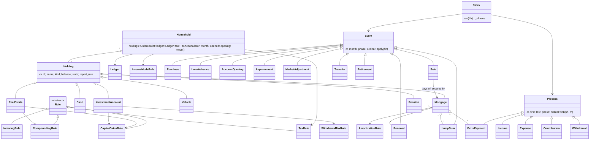

# State-machine engine: feasibility report

Scope: re-implement `webapp/engine.py` (1130 lines, 151 tests) as a household aggregate whose
state is changed by events and rule objects, with the same public API, the same JSON
input and identical output (`rows`, `holdings`, `ledger`, `tax`). This is analysis only.

## 1. Verdict: feasible, with caveats

The current engine already behaves like a state machine. It has mutable holdings, a
movement ledger and a fixed sequence of steps each month. Everything it does is
deterministic Decimal arithmetic with no hidden I/O, so identical output can be achieved.

The caveats come from the requirement for identical results:

- **Order is part of the contract.** Ledger order is output. The dispatcher must
  therefore be a **phased, totally ordered clock**, not a free event bus or observer
  graph. Within a month, order is (phase, item ordinal, sub-step). See §2.
- **"An event creates the object" must keep its slot.** `holdings` output and every
  loop that walks holdings use scenario **item order**, and that includes holdings bought
  later. Aggregates are therefore built up front in state `PLANNED` (balance `None`), and
  the Purchase, LoanAdvance or AccountOpening event *transitions* them to `ACTIVE`. Only
  the transition is the event; the object already exists.
- **Recurring processes dominate.** About 80–90% of ledger lines come from time-driven
  processes: interest, payments, growth, flows and tax. Discrete events are a small part.
  The redesign mainly buys structure: per-object classes, rules as objects and clean
  transitions. It does not make the arithmetic simpler.
- **The arithmetic must be copied expression for expression.** Decimal at precision 28
  gives different last digits when the algebra is rearranged, for example
  `base*(1+r)**k/d` versus `base/d*(1+r)**k`.
- **There is no capital-gains rule today.** C-M8 is a known gap. A `CapitalGainsRule`
  can be referenced by RealEstate and InvestmentAccount, but under the parity requirement
  it must be a no-op.

## 2. Monthly step order mapped onto events and processes

**Discrete events** are dated and fire once:

- Purchase (property or vehicle, with an optional `marketValue` REVALUATION)
- LoanAdvance (mortgage start)
- AccountOpening (from cash, or from outside)
- Improvement
- MarketAdjustment (`percent` or `newValue`, where `newValue` sets `fixedAt`)
- Sale (price difference, SALE, SELLING_COST, payoff of secured loans, PENALTY)
- Transfer
- Renewal (penalty, new rate, new payment)
- LumpSum (with its penalty)
- FirstPayment (the interest-adjustment payout)
- Retirement (tax-rate switch)

**Recurring processes** are active over `[first, last]` and fire every month:

- income
- pension payment
- mortgage service (interest, payment, extra payments)
- expense
- vehicle maintenance
- contribution and employer match
- withdrawal
- growth (appreciation, depreciation, returns)
- pension revaluation
- tax

**Model.** A `Clock` runs each month m as a fixed list of **phases**. Each handler, whether
a dated event or a recurring process, is registered under a key
`(phase, ordinal[, sub])`. `ordinal` is the scenario item index. That index also gives
the holdings order, because holdings are inserted in item order after cash. The phase
table below is binding: it is exactly the order of `Simulation.step` in today's engine.

| # | Phase | Handlers, in order | Notes |
|---|-------|--------------------|-------|
| 0 | OPEN | reset taxable, deductions, extra_tax; `opened` = non-cash holdings with balance≠None; `opening` snapshot | the `opened` list is frozen for phases 8 and 13 |
| 1 | INCOME | income flows, item order | skipped when `expensesCovered` |
| 2 | PENSION_PAY | pensions, holdings order | taxable if flagged |
| 3 | ACQUIRE | holdings with `at==m`: opening, advance or purchase(+revaluation) | one loop, mixed kinds, item order |
| 4 | IMPROVE | improvements, item order | before adjustments |
| 5 | ADJUST | market adjustments, item order | percent applies to the balance after improvement |
| 6 | SELL | assets with `saleAt==m`, holdings order; loans paid off in holdings order | before transfers |
| 7 | TRANSFER | transfers, item order | RRSP: deduction unless covered |
| 8 | SERVICE_DEBT | `opened` mortgages with balance>0 *now*, holdings order. Per loan: renewal → PENALTY; if m<firstPay accrue and stop; else pay accrued INTEREST_ADJUSTMENT, LOAN_INTEREST, LOAN_PAYMENT, then that loan's extras in item order (lump sum followed by its PENALTY) | extras are sub-steps of the loan, not a separate phase |
| 9 | EXPENSE | expense flows, item order | |
| 10 | MAINTAIN | vehicles with balance≠None and not sold | includes the purchase month |
| 11 | CONTRIBUTE | contributions, item order | target balance≠None; a pension target goes to outside |
| 12 | WITHDRAW | withdrawals, item order | percent and even modes keep state |
| 13 | GROW | `opened`, holdings order | on the `opening` balance; skip sold or `fixedAt` assets |
| 14 | REVALUE_PENSIONS | all pensions | negative amounts allowed |
| 15 | TAX | TaxRule | always writes `tax_detail`; TAX move only if non-zero |
| 16 | CLOSE | row and per-holding point | outside `step()` in today's engine |

**Retirement.** Recommendation: resolve retirement-relative anchors **when the schedule is
compiled**, as `prepare()` does today. That covers `startsAtRetirement`,
`endsAtRetirement`, `atRetirement`, and pensions or withdrawals with a blank start. A live
`RetirementEvent` then only flips the household's `retired` flag, which TaxRule reads.
Turning flows on and off at run time would also work, but it would have to reproduce
`last = retirement-1` and indexing measured from the effective `first`. That adds risk
for no gain.

## 3. Class model

- **Household** (main object): an ordered `holdings` registry with cash first, the
  `Ledger`, the month context (`m`, `opened`, `opening`), a `TaxAccumulator` (taxable,
  deductions, extra_tax, pool), the scenario settings (inflation, base, income mode,
  retirement) and its rules.
- **Aggregates**: one base class `Holding` (id, name, kind, balance, state,
  `report_rate`). Each holding has a lifecycle:
  - `Cash`
  - `RealEstate`, `Vehicle`: PLANNED → ACTIVE → SOLD
  - `Mortgage`: PLANNED → ACCRUING (before the first payment) → AMORTIZING → PAID_OFF
  - `InvestmentAccount`: PLANNED → OPEN
  - `Pension`: always valued
- **Flows** are recurring and not holdings: `Income`, `Expense`, `Contribution`,
  `Withdrawal` (Amount, Percent and Even strategies) and `ExtraPayment`, which attaches
  to its Mortgage.
- **Events** are dated and implement `apply(household)`: `Purchase`, `LoanAdvance`,
  `AccountOpening`, `Improvement`, `MarketAdjustment`, `Sale`, `Transfer`, `Renewal` and
  `LumpSum` (both attached to their Mortgage), and `Retirement`.
- **Rules** are stateless, except TaxRule's pool, which lives on the accumulator.

  | Rule | What it does | Used by |
  |------|--------------|---------|
  | `CompoundingRule` | semi-annual monthly rate, annual→monthly power | Mortgage, Renewal, RealEstate, Vehicle, InvestmentAccount |
  | `AmortizationRule` | annuity; the last payment clears the remainder | Mortgage |
  | `IndexingRule` | none, inflation or custom; anniversary step | Income, Expense, Contribution, Withdrawal(amount), Vehicle maintenance, Pension |
  | `IncomeModeRule` | source cash or outside | Household; used by flows and the mortgage |
  | `InvestmentIncomeRule` | non-registered positive return is taxable | InvestmentAccount |
  | `WithdrawalTaxRule` | RRSP: own rate goes to extra_tax, otherwise taxable | InvestmentAccount |
  | `DeductionRule` | RRSP contribution or transfer, pension contribution | InvestmentAccount, Pension |
  | `TaxRule` | flat rate, retirement switch, carry-forward pool | Household |
  | `CapitalGainsRule` | no-op for parity | RealEstate, InvestmentAccount |
  | `RealValueRule` | real net worth | Household results |

- **Scheduler and Clock**: a `Compiler` turns items into aggregates, flows and events and
  registers them as `(phase, ordinal)` handlers. The `Clock` runs the months and phases.
  `Results` builds rows, holdings detail (loan interest and paid amounts come from the
  ledger) and tax.



## 4. Risks to identical output, and mitigations

1. **Rounding points.** Today `move()` rounds every movement, and these values are rounded
   where they are calculated: `annuity`, `indexed`, `pension_payment`, `pension_value`,
   the pre-horizon value (one integer power, not monthly steps), the percent and even
   withdrawal monthly amounts, the tax amount due and the real net worth. Two values are
   **not** rounded where they are calculated:
   - `extra_tax` builds up unrounded and is rounded once in TAX.
   - With `amountIn: base`, the inflated amount stays unrounded until `indexed`.

   *Mitigation:* one `arith.py` copied verbatim (`money`, `power`, `monthly_rate`,
   `annuity`, `indexed`, `pension_value`). Rules call it and never re-derive a formula.
   Never touch the Decimal context.
2. **A zero amount is not recorded.** `move()` drops amounts that round to 0 and returns
   0. Negative amounts *are* recorded: REVALUATION, MARKET_ADJUSTMENT, APPRECIATION for
   vehicles, SALE_PRICE_DIFFERENCE. *Mitigation:* the Ledger keeps these semantics
   exactly. A liability's sign is flipped in a single place.
3. **Ledger order.** It follows from the phase table and item ordinals. Two hazards:
   - The ACQUIRE loop mixes kinds, so a mortgage item listed before its property advances
     first.
   - Loan payoff in SELL and extras in SERVICE_DEBT are nested loops.

   *Mitigation:* a single ordered registry; the phase table as a test; the differential
   harness reports the first ledger entry that diverges.
4. **The `opened` and `opening` snapshot.** Debt service and growth only run on holdings
   that existed at the start of the month, and growth is computed on the opening value.
   For an account opened this month, a percent withdrawal reads the *current* balance,
   after the opening and contributions (`opening.get(id, balance)`). The even drawdown is
   fixed in the first active month with a non-zero balance. *Mitigation:* the Household
   freezes `opened` and `opening` in OPEN. Replicate the fallback and the
   "first non-zero month" latch explicitly.
5. **Interactions within the same month:**
   - Sale, then the loan is skipped (balance 0 in SERVICE_DEBT), and the sold asset gets
     no growth or maintenance.
   - Sale before transfer.
   - Improvement before adjustment, and the percent adjustment applies to the improved
     value.
   - Renewal annuity on the balance at that moment, then interest.
   - Accrual before the first payment: LOAN_INTEREST raises the loan; INTEREST_ADJUSTMENT
     later pays from cash, or from outside when covered.
   - payOff = the balance after the scheduled payment.
   - Pension revalued after its payment.

   *Mitigation:* encode each one as a named sub-step on its aggregate, each with a
   regression test taken from today's tests.
6. **Tax accumulator.** `taxable` adds rounded amounts. The non-registered return adds
   `max(0, ret)`. The pool is carried forward. The rate switches when `m >= retirement`.
   `tax_detail` keys are written in a fixed order. *Mitigation:* TaxRule is ported
   verbatim and every rule writes through `TaxAccumulator` methods.
7. **Output shapes:**
   - Key order of rows, including the realNetWorth keys added at the end.
   - Holdings points: `opening` is `None` in the month a holding is created.
   - `rate` is the per-kind monthly rate: the mortgage rate changes on renewal; a pension
     shows its indexing rate; cash shows `None`.
   - Sold holdings stay in the result with a closing balance of 0.
   - Loan interest and paid amounts are summed from ledger kinds.

   *Mitigation:* `Holding.report_rate`; `Results` ported verbatim.
8. **Validation messages.** The first error raised depends on the loop order and the
   checks inside `validate()`. *Mitigation:* port `validate`, `property_sales` and
   `check_amortization` verbatim as a pure module. Do not split them across event
   constructors (that is open question 3).
9. **Legacy input:**
   - property `saleDate` (the sale id then falls back to the property id)
   - scenario `retirementDate`
   - `monthlyAmount`
   - a sale at retirement, which is a copied item

   *Mitigation:* the Compiler reuses `property_sales` and `retirement_date`.

## 5. Parity strategy

**API facade.** `webapp/state_machine/engine.py` must export every symbol the tests and app
use. From `grep engine.`:

- app.py uses `validate`, `run`, `run_detailed`, `retirement_date`, `month_label`,
  `month_index` and `base_month`.
- test_engine.py uses `run`, `run_detailed`, `retirement_date`, `annuity`,
  `monthly_rate` and `mortgage_terms`, plus `from engine import money`.
- `import app` pulls in `engine` as well.

**Same tests, unchanged.** Run from the package directory so that its `engine.py` shadows
the old one, and put `webapp` on the path for `app` and `test_engine` (samples resolve
through `__file__`):

```
cd webapp/state_machine && PYTHONPATH=.. ../.venv/bin/python -m unittest -q test_engine
```

The facade imports `state_machine.*` by absolute path. It can do that because `webapp` is
on `sys.path`.

**Differential harness** (`webapp/state_machine/tools/diff_engines.py`):

1. Load the reference engine with `importlib` from `webapp/engine.py` as `engine_ref`, and
   load the new engine.
2. For each scenario, compare `validate` (exception type and message) and
   `repr(run_detailed(s))`. `repr` keeps Decimal exponents (`0.00` versus `0`), `None`
   and key order, so it is a byte-identical check.
3. When they differ, report the first diverging section: the rows, the holdings point
   (id, month) or the ledger index with both entries.

Scenario sources:

- (a) `webapp/samples/*.json`
- (b) **recorded test scenarios**: run the 151 tests once with a shim that captures every
  scenario passed to `run` and `run_detailed` into a local fixture directory
- (c) extra local paths passed on the command line, such as the owner's untracked personal files,
  which are never committed
- (d) optional seeded random scenarios built from valid templates, with mutated dates,
  rates and same-month collisions

## 6. Work packages

File layout under `webapp/state_machine/`: `engine.py` (facade), `api.py`, `arith.py`,
`dates.py`, `validation.py`, `ledger.py`, `household.py`, `clock.py` (phases and
registry), `base.py` (Holding, Event, Process, Rule), `compiler.py` (type→factory
registry), `results.py`, `rules/{tax,indexing,compounding,income_mode,investment,capital_gains}.py`,
`holdings/{cash,real_estate,vehicle,mortgage,account,pension}.py`,
`flows/{income_expense,contribution,withdrawal}.py`,
`events/{acquire,improvement,adjustment,sale,transfer,retirement}.py`, `tools/diff_engines.py`.

| WP | Content | Depends on | Parallel? |
|----|---------|------------|-----------|
| WP0 Core | `base`, `ledger`, `household`, `clock` (phase enum, keyed registry), `compiler` with a self-registering factory decorator, `api` and `engine` facade stubs, `arith` and `dates` copied verbatim | none | first, alone |
| WP1 Validation | `validation.py`: verbatim `validate`, `property_sales`, `retirement_date`, `check_amortization`, `REQUIRED` | WP0 (`arith`, `dates`) | yes |
| WP2 Harness | `tools/diff_engines.py`, recorder shim, fixture capture | WP0 facade | yes, and needed early |
| WP3 Real assets | RealEstate, Vehicle; Purchase, Improvement, MarketAdjustment, Sale (payoff through `household.loans_secured_by`); growth; maintenance | WP0 | yes |
| WP4 Debt | Mortgage lifecycle, LoanAdvance, Renewal, ExtraPayment, LumpSum, interest adjustment | WP0 | yes |
| WP5 Investments | InvestmentAccount, AccountOpening, Transfer, Contribution (pension target through `accept_contribution`), Withdrawal strategies | WP0 | yes |
| WP6 Pensions | Pension holding: payment, valuation, revaluation, `accept_contribution` | WP0 | yes |
| WP7 Flows and rules | Income and Expense; IndexingRule, CompoundingRule, IncomeModeRule, TaxRule with pool and detail, CapitalGainsRule no-op | WP0 | yes |
| WP8 Results | rows, holdings detail with loan interest and paid amounts, real net worth, tax detail | WP0 | yes |
| WP9 Integration | wire the compiler registry, run the 151 tests through the facade and the harness on all fixtures, fix divergences | all | last |

WP0 must pin down the interfaces: `Household.move`, the phase enum, the handler
signature, `TaxAccumulator` methods and the `Holding` fields. That lets WP3–WP8 touch
disjoint files. Only WP9 edits shared wiring.

Branches:

- `poc/state-machine` is the integration branch.
- Each work package gets its own `poc/sm-wpN-<name>` branch, cut from it after WP0 lands,
  one worktree per agent.
- Each is merged back with `--no-ff` once its unit tests pass. Full parity is only
  required at WP9.

## 7. Open questions for the user

1. **Object creation.** Do you accept that aggregates are pre-registered in state PLANNED,
   so that a Purchase *activates* them rather than instantiating them? This is needed for
   identical holdings and ledger order.
2. **Retirement.** Should it be resolved at compile time, with a live RetirementEvent that
   only switches the tax rate (recommended)? Or should it be a full runtime event that
   starts and stops flows?
3. **Validation.** Port it verbatim as one pure function (recommended), or move it into
   event and aggregate constructors, which risks a different message order?
4. **Independence.** Must the new package be standalone, copying `arith`, `dates` and
   `validation`? Or may it import helpers from `webapp/engine.py`? After parity, which
   engine is the reference for new features?
5. **Fixtures.** May a sanitized fixture like the owner's scenario be committed for the harness, or
   should it stay local only?
